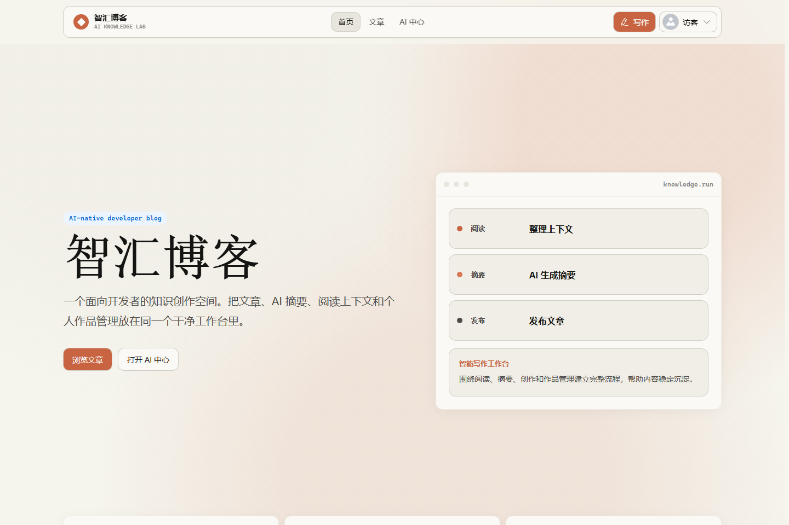
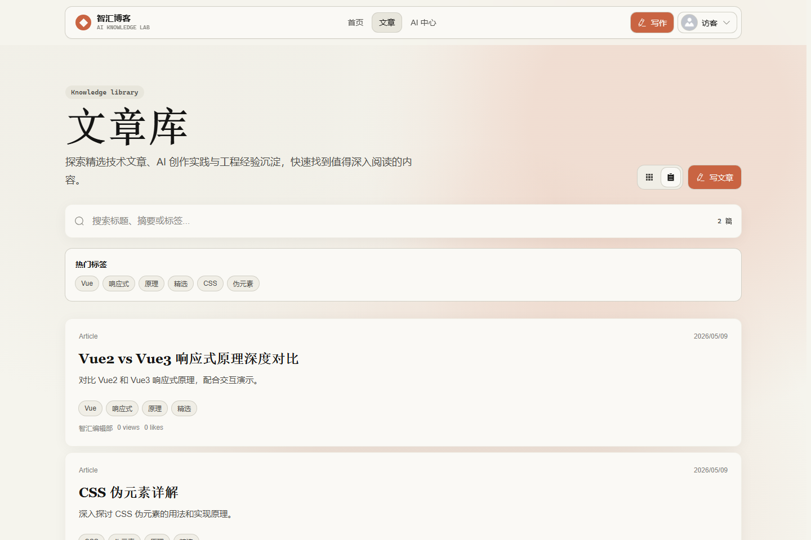
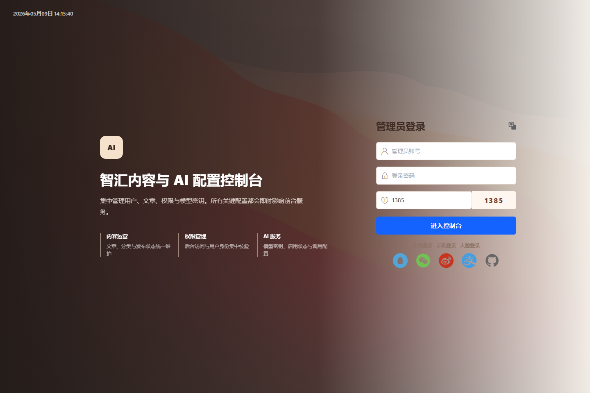

# AI-Vue3-python-flask-Blog

**Vue 3 + Python Flask + Celery + Redis + MySQL + Docker + RAG** 全栈 AI 博客系统。

本项目已经包含前台博客、后台管理、后端 API、数据库、登录鉴权、文章管理、评论收藏和基础 AI 能力。它不是一个空壳模板，而是可以直接运行、部署、演示和继续扩展的完整项目。

原作者vue3 + flask系统体验：
线上体验：[https://ai-vue3-python-flask-blog.vercel.app/](https://ai-vue3-python-flask-blog.vercel.app/)
项目展示页：[linsk27 projects - AI-Vue3-python-flask-Blog](https://linsk27.github.io/projects/ai-vue-flask-blog/)

> 使用声明：本项目仅供学习交流、课程设计、毕业设计和个人非商业二次开发参考使用，禁止商业用途。

如果你想对这个项目做扩展最好采用原作者linsk27的基础框架，因为现在这个作品不保证兼容性。

适合搜索关键词：**Vue Flask 前后端分离、AI 博客系统、MySQL 管理系统、前后端分离博客系统、Celery、Redis、Docker、基础RAG**。

## 使用声明

本项目仅供学习交流和个人非商业二次开发参考使用。未经作者许可，禁止将本项目源码、页面设计、文档或改造版本用于商业售卖、付费课程、外包交付、SaaS 服务、企业项目等商业用途。

## 页面截图

### 前台首页



### 文章库



### 管理后台登录



## 核心功能

### 用户端

- 首页展示与文章列表
- 文章详情、阅读、评论、点赞和收藏
- 用户注册、登录和个人中心
- 文章创建、编辑、发布和删除
- AI 辅助写作与 AI 对话入口
- RAG 辅助 AI 生成回答

### 管理后台

- 用户管理
- 文章管理
- 角色和权限管理
- AI 模型配置
- 后台运营管理页面

### 后端

- JWT 登录鉴权
- 用户、文章、评论、收藏接口
- 图片上传接口
- AI 生成与对话接口
- Celery 异步处理各种任务
- Redis 缓存
- MySQL 数据持久化
- Docker 一键部署项目
- Prompt
- RAG 辅助 AI 生成回答

## 技术栈

### 前台 `front/`

- Vue 3
- Vite
- TypeScript
- Pinia
- Vue Router
- Element Plus

### 管理后台 `avue-cli/`

- Vue 3
- Vite
- Avue
- Element Plus
- Axios

### 后端 `backend/`

- Python Flask
- SQLAlchemy
- PyMySQL
- MySQL
- JWT
- Flask-CORS
- OpenAI-compatible API
- Celery
- Redis
- Docker
- RAG

## 项目结构

```text
AI-Vue3-python-flask-Blog/
├── front/        # 用户端前台
├── avue-cli/     # Avue 管理后台
├── backend/      # Flask 后端 API
└── README.md
```

## 本地启动

### 1. 后端

```bash
cd backend
pip install -r requirements.txt
python init_db.py
python app.py
```

默认后端地址：

```text
http://127.0.0.1:5000
```

### 2. 用户端前台

```bash
cd front
npm install
npm run dev
```

### 3. 管理后台

```bash
cd avue-cli
npm install
npm run dev
```